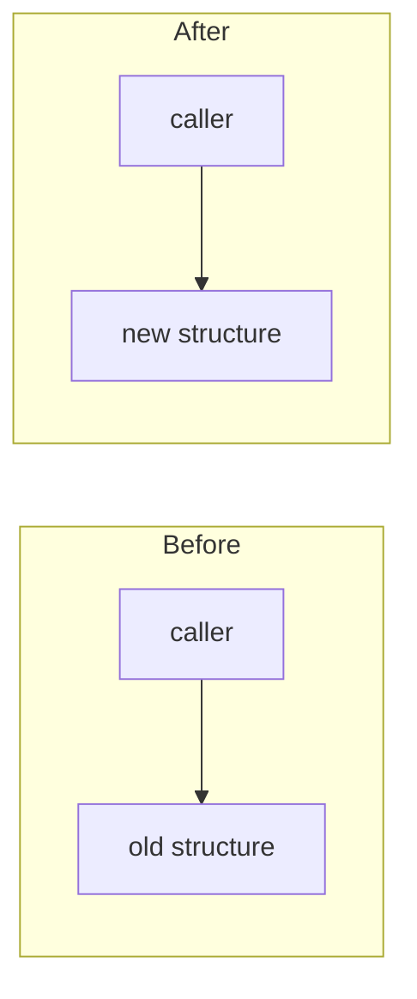

## Why

The problem or goal, in one or two sentences.

## Before → after

Replace with the structure or flow this PR changes (module/class diagram, sequence or flowchart). Omit only for docs-only or one-line fixes.

## What changes for users

Behaviour an agent or user will notice, or "None".

## Evidence

- `pixi run check` / CI
- Native E2E on an isolated test instance, if host behaviour or native bindings changed

## Risks and follow-ups

Only what a reviewer needs to know.
