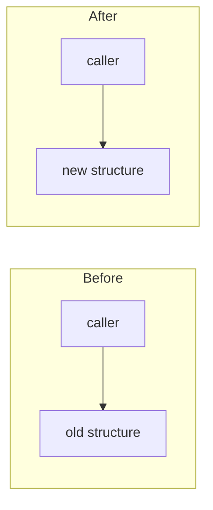

## Why

The problem or goal, in one or two sentences.

## Before → after

Replace with the structure or flow this PR changes (module/class diagram, sequence or flowchart). Omit only for docs-only or one-line fixes.

## What changes for users

Behaviour an agent or user will notice, or "None".

## Evidence

Reproducible evidence only: a CI run link, or a command with its key output or artifact path. "Tests pass" is not evidence.

- CI run:
- Native E2E on an isolated test instance, if host behaviour or native bindings changed: script, log path, pass/fail derived from the recorded responses
- Refactors: the invariant check that proves behaviour is unchanged (for example, a before/after schema dump hash)

## Checklist

- [ ] CHANGELOG.md Unreleased updated (user-visible changes)

## Risks and follow-ups

Only what a reviewer needs to know.
