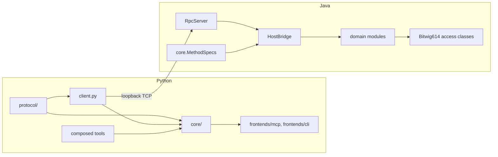

# Architecture and ownership

Bitwig Agent is a **thin, bounded control bridge**, not a music-planning service, autonomous session manager or complete project model. The agent chooses a plan within the user's permission, discovers current targets, issues a request and interprets the observed result. Bitwig owns project state and the audio engine. The bridge owns transport, validation, bounded observations and domain-specific admission/completion checks.

This guide describes the public Python/Java implementation. [PROTOCOL.md](../PROTOCOL.md) remains the detailed contract for fields, limits, side effects and recovery boundaries; [VERIFICATION.md](../VERIFICATION.md) describes evidence rather than architecture promises.

## Interfaces and process boundaries

| Boundary | Interface | Owner and responsibility |
|---|---|---|
| Human to agent | Task, scope and explicit permissions | Human owns acceptance and permission; agent owns planning and evidence interpretation |
| MCP client to Python adapter | MCP over stdio | Client launches `bitwig-agent-mcp`; adapter exposes the shared catalog and returns structured/text envelopes |
| CLI to Python client | `bitwig-agent-rpc` | Same catalog/validation, with offline list/describe/help and host-facing calls |
| Python to Java extension | One newline-delimited JSON request/response per loopback TCP connection | Correlation, bounds, deadlines and error/outcome preservation; no replay |
| Network handler to controller host | Scheduled domain operation | Java validates and schedules; network threads do not operate the host model |
| Controller/private native model | Public Controller API or exact-version native adapters | Domain-specific target checks, observation and write admission; Bitwig remains the state authority |
| User to extension installation | `bitwig-agent-install` | Separate filesystem operation, matching release assets, checksum check and backup; not a DAW operation |

The extension binds `127.0.0.1:61172`; the Python client connects to IPv4 loopback. The endpoint is **unauthenticated**. Any local process able to connect can control the host. Context tokens and expected names protect against some stale targeting; they are not credentials. Do not expose or forward the port to a network. `BITWIG_AGENT_PORT` changes the Python connection port, not the Java listener.

## Python ownership

| Public source | Responsibility |
|---|---|
| [`protocol/`](https://github.com/BANANASJIM/bitwig-agent/blob/main/src/bitwig_agent/protocol) | One module per domain: strict typed request models with cross-field constraints plus that domain's catalog entries (descriptions, examples, read-only hints); the registry and validation are used by both adapters |
| [`client.py`](https://github.com/BANANASJIM/bitwig-agent/blob/main/src/bitwig_agent/client.py) | Bounded strict JSON, one-shot loopback requests, unique correlation IDs, response validation and conservative outcomes |
| [`core/`](https://github.com/BANANASJIM/bitwig-agent/blob/main/src/bitwig_agent/core) | The one call path and discovery data both front ends use: `invoke` validates, dispatches to the host client or a composed handler and wraps the outcome in an envelope; `views` reads the method table; `composed` maps the client-side tool names to their handlers |
| Composed tools: [`grid/`](https://github.com/BANANASJIM/bitwig-agent/blob/main/src/bitwig_agent/grid), [`audio/`](https://github.com/BANANASJIM/bitwig-agent/blob/main/src/bitwig_agent/audio), `presets.py`, `modulator_docs.py`, `diagnostics.py` | Client-side tools registered in `composed.HANDLERS`: they call the host through `BridgeClient` or read the local Bitwig install and audio files, and never touch the host model directly |
| [`frontends/mcp.py`](https://github.com/BANANASJIM/bitwig-agent/blob/main/src/bitwig_agent/frontends/mcp.py) | MCP tool discovery and invocation over stdio (`bitwig-agent-mcp`); the exposed methods plus `help`; the result (or error) object is the structured content and its text |
| [`frontends/cli.py`](https://github.com/BANANASJIM/bitwig-agent/blob/main/src/bitwig_agent/frontends/cli.py) | CLI argument parsing and discovery layout on top of `core` (`bitwig-agent-rpc`); exit code from the envelope |
| [`install.py`](https://github.com/BANANASJIM/bitwig-agent/blob/main/src/bitwig_agent/install.py) | Release-version extension download/copy, integrity check, backups and printed MCP configuration |

The catalog is not a planner. Tool examples are schema examples, not live target IDs. Tool annotations are hints, not authority or a proof that a call has no side effects. For example, `notes.read` selects a clip.

Python rejects invalid arguments before dispatch, including unknown fields and inappropriate value types. Java independently validates the transport and domain request; calling TCP directly does not remove host-side checks. The maintained Python dependency range is Python 3.11+, `mcp>=2.3.0,<3` and `pydantic>=2.12,<3`; the source lockfile selects exact development versions. The adapter uses the SDK 2 low-level constructor handlers and explicit result models. SDK attributes use snake_case; MCP wire fields retain their camelCase aliases, and the shared validator—not SDK convenience wrapping—owns argument validation. Package dependency resolution and native host compatibility are different concerns.

## Java ownership

The main sources are under [`extension/src/main/java/dev/bitwigagent`](https://github.com/BANANASJIM/bitwig-agent/tree/main/extension/src/main/java/dev/bitwigagent).

- `BitwigAgentExtension` creates the bridge/listener, forwards controller flushes and closes services on exit.
- `RpcServer` owns transport framing, admission and bounded response delivery. It does not own project state, selection or domain business logic.
- `core.MethodSpecs` reads the `protocol.json` bundle generated from the Python `protocol/` package (method names, timeouts, write/engine flags). `HostBridge` registers each `HostModule` by method name, fails at start-up if the bundle and the registered handlers differ, checks every request against the method's exported JSON Schema (`core.SchemaValidator`, which also fills schema defaults and refuses to load a schema using a keyword it does not implement), routes validation to the owning module and schedules each `HostOperation` through the `Scheduler`. Each module still validates its own parameters in `HostModule.validate`.
- Shared host state is split by job, and `HostBridge` passes each module only the services it uses:
  - `Scheduler` owns the one clock, deadlines, `schedule` and `poll`, so no module times its own loop.
  - `TrackWindow` owns the fixed track, device and parent banks and slot lookup by track id.
  - `ProjectState` owns project readiness, the modified flag and the audio engine.
  - `TransportSafety` owns the single rule set for recording, automation-write and playing state.
  - `SelectionLease` owns the editor selection that launcher cursor operations bind, and `LauncherStructureLock` says what pins launcher slot rows.
  - `NativeRuntime` is the lazy shared gate to the native bindings.
  - `Holds` owns every unresolved or in-flight write: `status` lists them, writes in the domain are refused while one stands, and `AckModule` (`ack`) releases an unresolved one. `JobsModule` (`jobs.get`) reports the long jobs that in-flight holds stand for.
- `HostOperation` tracks deadlines and turns a failure after dispatch into an unknown result. Host API work crosses the scheduler boundary rather than running on the network thread.
- `DeviceSources` owns fixed root/layer/child addresses and continuity observations. `ParameterModule` owns continuously observed source-specific parameter data and the single shared active binding/request. Switching flat or nested targets invalidates the prior binding.
- Discovery, Actions, transport, mix, devices and Launcher/MIDI have separate domain modules and observations. Their result semantics differ: a dispatch-only Action is not equivalent to an acknowledged parameter change.
- `GridModule` separates target/RPC guards from bounded graph serialization and scalar, boolean-panel and topology writers. `GridTopologyQuarantine` serializes native topology lifetimes and keeps one quarantine record per Grid device, released only by `ack` after a graph re-check.
- `ProjectModule` owns `project.save` (public Save action) and `project.saveAs`; `ProjectSaveAsPlan` mirrors the native folder rules host-free and `Bitwig614ProjectSaveAsAccess` calls the dialog-free save pipeline with a completion callback.
- `RenderModule` owns `export.audio` and `bounce.inPlace` (followed with `jobs.get`); `RenderPlan` names the output files and checks their headers host-free, and `Bitwig614RenderAccess` starts the native render jobs and exposes their completion latch (bounce readback reuses `Bitwig614ArrangerAccess`).
- `RoutingModule` owns `tracks.routing.*` and `devices.sidechain.*` (validation, bank/device targets, stopped-transport safety and quarantine); `Bitwig614RoutingAccess` binds the native output/input choosers and sidechain components, enforces audio/note kinds, checks cycles before writing and reads every write back by identity.
- `ModulatorModule` and `ModulatorSnapshotReader` own bounded, nonloading primary-modulator reads. They share root target/read-context machinery, not Grid write authority.
- `ModulatorEditModule` (RPC boundary), `ModulatorEditor` (CAS, dispatch, readback) and `Bitwig614ModulatorEditAccess` (descriptors) own device-modulator edits. They reuse the Grid parameter reader for typed values and Grid targets, and the Grid parameter/topology context checks, but not Grid write authority or topology quarantine.

`Bitwig614TrackResolver` maps a public track proxy to its native track model and identity for the render and automation accessors. `Bitwig614Runtime` is lazy and shared through `NativeRuntime`. It checks the exact host version, loaded JAR CodeSource/hash/ClassLoader and mapped descriptors before private dispatch. Native target/read-context helpers corroborate ownership and lifecycle. Grid and modulator availability remains independently reported; successful read binding does not enable a writer.

The unnamed-package [`BitwigAgent614GridInsertion.java`](https://github.com/BANANASJIM/bitwig-agent/blob/main/extension/src/main/java/BitwigAgent614GridInsertion.java) is intentional: the native superclass is in that package and the loader expects the exact class name. It is a narrow insertion boundary, not another transport, planner or generic transaction framework.

## Request lifecycle and outcomes

1. The agent inspects the installed method schema and obtains fresh discovery/target data. The user, not a token or tool description, supplies authorization.
2. Python validates and creates a bounded JSON request with a unique `id` and `timeoutMs`. IDs correlate replies; they are not persistent idempotency keys.
3. The loopback transport admits the request and Java validates/routes it. Host work is scheduled with a monotonic deadline; deferred mutations check that deadline too.
4. The domain rechecks the relevant target, context and safety observations. If eligible, it dispatches the operation and observes the method-specific evidence.
5. The reply is a result or an error. A write result carries an `outcome`; an error always means nothing changed. MCP/CLI preserve that distinction (`isError` / exit 1 for an error or an outcome other than applied, already_matched or sent). The agent must read the outcome, not merely whether a JSON result exists.

Outcomes, errors, holds and recovery are defined once in [PROTOCOL.md](../PROTOCOL.md#results-errors-and-recovery); a transport timeout after a write's dispatch is an `unknown` result, never "failed, therefore retry."

The deadline is not cancellation or rollback. The client adds a short response-delivery grace without extending/replaying the host request. It never retries automatically. One call can have several native effects, and undo-aware native dispatch does not establish one-call/one-Undo grouping.

On uncertainty, stop the writer, retain the response and ownership record, and reconcile through authorized inspection. Do not blindly retry through either the API or GUI. An unknown write leaves a hold that is released by `ack` after inspection, never by a restart (which proves no rollback); native topology lifetimes have specific rules. Topology admission can survive extension classloader replacement in the same JVM. Follow the exact [protocol recovery boundaries](../PROTOCOL.md#shared-topology-lifecycle-admission), not an improvised reset.

## What a target means

Public track UUIDs, root device indices and exact names address the **currently observed bank**. Direct parameters add source-bound context tokens; Remote Controls have an observed-page context; one-hop layer targets add discovery/context tokens. Grid controls require discovered module/port/control IDs and fresh raw compare-and-set preconditions. These mechanisms reject important stale-target cases, but are not persistent physical identity, a project revision lock or atomic exclusion of all host/user activity.

Names can change, same-metadata replacement can be ambiguous, and module/modulator UUIDs can change on reopen. Reacquire all relevant bindings when targets or project lifetimes change. `null`/unreadable/unsupported data is unknown, never an empty collection, zero, false or permission by default.

## Bounded coverage and compatibility

- Track and scene windows come from `src/bitwig_agent/protocol/limits.py` through the protocol bundle; root devices are 16 per track and sends eight. Layers expose one hop with two layers and two children per layer. There is no general project paging or arbitrary nested traversal.
- A Grid page's `window.complete` is page coverage. Whole-result coverage may still be partial, and stored connections are not proof of the active DSP graph.
- MIDI reads use explicit channel/grid/window bounds and do not establish lossless arbitrary-clip export; selection/grid settling is not a general acknowledgement barrier.
- String panels are written only through `grid.parameters.set`/`grid.apply` (Grid modules, e.g. Comment TEXT). Arranger clips (`arranger.clips.*`), arranger automation points (`automation.points.*`) and track routing/device sidechains (`tracks.routing.*`, `devices.sidechain.*`, bank tracks only; hardware entries deferred) use version-gated native access; launcher automation, automation clips and dedicated master/cue tools are outside the structured surface.
- Version `0.2.0` maps private access to **Bitwig 6.1.4 / API 25** and the exact loaded host-JAR hash; the older `0.1.2` release retains its 6.1.3 boundary. This is a single-version cutover, not a compatibility platform. [Native evidence](../VERIFICATION.md) is bounded to exercised Linux cases; a host package or successful macOS/Windows Python install does not extend it. Do not bypass the gate.

The agent can explicitly use separately authorized Computer Use for an unsupported operation, but there is no implicit GUI fallback.

## Repository map

| Path | Responsibility |
|---|---|
| `src/bitwig_agent/` | Protocol and catalog, transport client, core call path, composed tools, MCP and CLI front ends, release installer |
| `extension/src/main/java/dev/bitwigagent/` | Host services, domains and bounded native adapters |
| `extension/src/test/`, `tests/` | Simulated-host Java checks and host-free Python regressions |
| `scripts/` | Source builds/checks and offline evidence helpers |
| `examples/` | Client configuration and explicit opt-in music recipes |
| `docs/` | Public architecture, installation navigation and packaging guides |
| `packaging/aur/` | Reviewed AUR recipe and synchronized `.SRCINFO` |
| `skills/bitwig-agent/` | Copyable Agent Skills instructions, focused references and MIT license |

## Layers

Enforced by tests: `protocol/` imports only the standard library, pydantic and itself; front ends import only `core` among internal modules. The Java sources are one package, `dev.bitwigagent`, plus `core`; the layering is by role, not by subpackage. Splitting the flat Java package and the top-level audio modules into narrower packages is planned and not yet done.

## Evidence is layered

Schema validation, package consumption, MCP startup, host connectivity, dispatch, model readback, GUI observation, audio rendering/listening, Undo/Redo and save/reopen are distinct observations. None automatically promotes the next layer to passed. The bridge intentionally reports bounded results rather than claiming a plan is musically correct or persisted. The human still owns acceptance.
