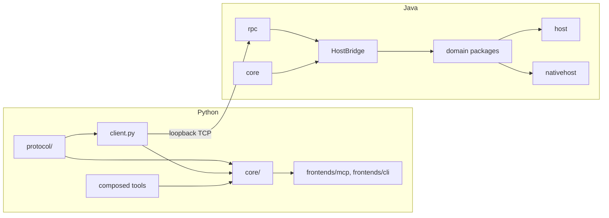

# Architecture and ownership

Bitwig Agent is a **thin, bounded control bridge**, not a music-planning service, autonomous session manager or complete project model. The agent chooses a plan within the user's permission, discovers current targets, issues a request and interprets the observed result. Bitwig owns project state and the audio engine. The bridge owns transport, validation, bounded observations and domain-specific admission/completion checks.

This guide describes the public Python/Java implementation. [PROTOCOL.md](../PROTOCOL.md) remains the detailed contract for fields, limits, side effects and recovery boundaries; [VERIFICATION.md](../VERIFICATION.md) describes evidence rather than architecture promises.

## Interfaces and process boundaries

| Boundary | Interface | Owner and responsibility |
|---|---|---|
| Human to agent | Task, scope and explicit permissions | Human owns acceptance and permission; agent owns planning and evidence interpretation |
| MCP client to Python adapter | MCP over stdio | Client launches `bitwig-agent-mcp`; adapter exposes the shared catalog and returns structured/text envelopes |
| CLI to Python client | `bitwig-agent` | Same catalog/validation, with offline help and host-facing calls; stdout data, stderr error, exit code from the outcome |
| Python to Java extension | One newline-delimited JSON request/response per loopback TCP connection | Correlation, bounds, deadlines and error/outcome preservation; no replay |
| Network handler to controller host | Scheduled domain operation | Java validates and schedules; network threads do not operate the host model |
| Controller/private native model | Public Controller API or exact-version native adapters | Domain-specific target checks, observation and write admission; Bitwig remains the state authority |
| User to extension installation | `bitwig-agent-install` | Separate filesystem operation, matching release assets, checksum check and backup; not a DAW operation |

The extension binds `127.0.0.1:61172`; the Python client connects to IPv4 loopback. The endpoint is **unauthenticated**. Any local process able to connect can control the host. Context tokens and expected names protect against some stale targeting; they are not credentials. Do not expose or forward the port to a network. `BITWIG_AGENT_PORT` changes the Python connection port, not the Java listener.

## Python ownership

| Public source | Responsibility |
|---|---|
| [`protocol/`](https://github.com/BANANASJIM/bitwig-agent/blob/main/src/bitwig_agent/protocol) | One module per domain: strict typed request models with cross-field constraints plus that domain's catalog entries (descriptions, examples, read-only hints); the registry and validation are used by both adapters |
| [`client.py`](https://github.com/BANANASJIM/bitwig-agent/blob/main/src/bitwig_agent/client.py) | Bounded strict JSON, one-shot loopback requests, unique correlation IDs, response validation and conservative outcomes |
| [`core/`](https://github.com/BANANASJIM/bitwig-agent/blob/main/src/bitwig_agent/core) | The one call path and discovery data both front ends use: `invoke` validates, dispatches to the host client or a composed handler and wraps the outcome in an envelope; `views` reads the method table; `composed` maps the client-side tool names to their handlers; `batch` runs several calls through `invoke` under the batch rule (the `batch` method of both front ends) |
| Composed tools: [`grid/`](https://github.com/BANANASJIM/bitwig-agent/blob/main/src/bitwig_agent/grid), [`audio/`](https://github.com/BANANASJIM/bitwig-agent/blob/main/src/bitwig_agent/audio), `presets.py`, `modulator_docs.py`, `diagnostics.py` | Client-side tools registered in `composed.HANDLERS`: they call the host through `BridgeClient` or read the local Bitwig install and audio files, and never touch the host model directly |
| [`frontends/mcp.py`](https://github.com/BANANASJIM/bitwig-agent/blob/main/src/bitwig_agent/frontends/mcp.py) | MCP tool discovery and invocation over stdio (`bitwig-agent-mcp`); the exposed methods plus `help`; the result (or error) object is the structured content and its text |
| [`frontends/cli.py`](https://github.com/BANANASJIM/bitwig-agent/blob/main/src/bitwig_agent/frontends/cli.py) | CLI argument parsing, help layout and exit codes on top of `core` (`bitwig-agent`) |
| [`install.py`](https://github.com/BANANASJIM/bitwig-agent/blob/main/src/bitwig_agent/install.py) | Release-version extension download/copy, integrity check, backups and printed MCP configuration |

The catalog is not a planner. Tool examples are schema examples, not live target IDs. Tool annotations are hints, not authority or a proof that a call has no side effects. For example, `clips.insert` selects a clip (and so does `notes.get` without the native note binding).

Python rejects invalid arguments before dispatch, including unknown fields and inappropriate value types. Java independently validates the transport and domain request; calling TCP directly does not remove host-side checks. The maintained Python dependency range is Python 3.11+, `mcp>=2.3.0,<3`, `pydantic>=2.12,<3` and `wcwidth>=0.3,<1` (display width of names in the text views); the source lockfile selects exact development versions. The adapter uses the SDK 2 low-level constructor handlers and explicit result models. SDK attributes use snake_case; MCP wire fields retain their camelCase aliases, and the shared validator—not SDK convenience wrapping—owns argument validation. Package dependency resolution and native host compatibility are different concerns.

## Java ownership

The main sources are under [`extension/src/main/java/dev/bitwigagent`](https://github.com/BANANASJIM/bitwig-agent/tree/main/extension/src/main/java/dev/bitwigagent).

| Package (`dev.bitwigagent.…`) | Owns |
|---|---|
| (root) | Composition only: `BitwigAgentExtension`, its definition and `HostBridge` wire services, modules and adapters |
| `rpc` | `RpcServer`: framing, bounds, admission; imports only `core` |
| `core` | Shared mechanisms: `MethodSpecs`, `SchemaValidator`, `Refs`, `Errors`/`ErrorCode`/`Reason`/`Outcome`, `Params`, `Results`, `Batch`, `Scheduler`, `HostOperation`, `HostModule`, `Holds`, value/match/position rules, display solving |
| `host` | Shared host observations and services: `TrackWindow`, `TrackRefs`, `ProjectState`, `TransportSafety`, `SelectionLease`, `LauncherStructureLock`, `NativeRuntime`, `DeviceSources`, `RequestSnapshot`, `NativeReadContext` |
| `grid`, `device`, `launcher`, `arranger`, `mix`, `project`, `render`, `routing`, `automation`, `transport`, `actions`, `recovery` | Domain modules and their host-free rules, one package per domain |
| `nativehost` | Version-gated native bindings: the only package that reflects into the host; host names come from the selected version's name table |

Tests mirror these packages. Domain packages mirror the Python `protocol/` modules, grouped as `device` (devices, chains, parameters, modulators), `launcher` (launcher, scenes, clips, notes), `arranger` (arranger, markers), `mix` (tracks, meters) and `project` (status, context, project).

Java `core` holds the extension's shared protocol mechanisms; Python `core` is the front-end-independent invoke/views layer.

Known couplings (follow-up; `tests/test_java_packages.py` is tightened once they are gone):

- Domain packages still name `nativehost.Native*` classes directly instead of going only through their ports.
- `nativehost` adapters still import domain types (for example `NativeRoutingAccess` uses `routing.RoutingPort` records and `routing.RoutingEntry`), but build no JSON and call no domain rules; `NativeAutomationAccess` only reads and writes points.
- `core.HostOperation` implements `rpc.RpcServer.Expiring`.
- `core.Results` takes `host.ProjectState.Readiness`.
- `host.DeviceSources` calls `device.NativeChains.nested`.
- `nativehost.NativeGridInsertionAccess` checks the origin of the root `BitwigAgentExtension`.

- `BitwigAgentExtension` creates the bridge/listener, forwards controller flushes and closes services on exit.
- `RpcServer` owns transport framing, admission and bounded response delivery. It does not own project state, selection or domain business logic.
- `core.MethodSpecs` reads the `protocol.json` bundle generated from the Python `protocol/` package (method names, timeouts, write/engine flags). `HostBridge` registers each `HostModule` by method name, fails at start-up if the bundle and the registered handlers differ, checks every request against the method's exported JSON Schema (`core.SchemaValidator`, which also fills schema defaults and refuses to load a schema using a keyword it does not implement), routes validation to the owning module and schedules each `HostOperation` through the `Scheduler`. Each module still validates its own parameters in `HostModule.validate`.
- Shared host state is split by job, and `HostBridge` passes each module only the services it uses:
  - `Scheduler` owns the one clock, deadlines, `schedule` and `poll`, so no module times its own loop.
  - `TrackWindow` owns the fixed track, device and parent banks and slot lookup by track id.
  - `ProjectState` owns project readiness, the modified flag and the audio engine.
  - `TransportSafety` owns the single rule set for recording, automation-write and playing state, including the `transport.set` recording guard. A method's required transport state is declared in its `requires` (`notRecording`, `stopped`, `projectReady`, `engine`) and admitted in `HostBridge.preflight`, before the module runs, from the enqueue observation and the current one; modules keep their own in-flight re-checks and add stricter per-request checks (Grid topology, `clips.set` Next Action).
  - `SelectionLease` owns the editor selection that launcher cursor operations bind, and `LauncherStructureLock` says what pins launcher slot rows.
  - `NativeRuntime` is the lazy shared gate to the native bindings.
  - `Holds` owns every unresolved or in-flight write: `status` lists them, writes in the domain are refused while one stands, and `AckModule` (`ack`) releases an unresolved one. `JobsModule` (`jobs.get`) reports the long jobs that in-flight holds stand for.
- `HostOperation` tracks deadlines and turns a failure after dispatch into an unknown result. Host API work crosses the scheduler boundary rather than running on the network thread.
- The device domain is split by what it proves. `DeviceListModule` lists a track's or a chain's devices; `DeviceChainModule` lists chains and owns the observed-delta verification of `devices.insert`/`delete`/`move` for a root chain and for a layer chain (`DeviceChainEdit` is the pure rule set); `DeviceModule` reads, bypasses and selects one device; `RemoteModule` owns each root device's own Remote Controls page (`devices.remote.get`, the internal page switch and the control write that `parameters.set` routes to it); `ParameterModule` lists and writes direct parameters.
- `DeviceSources` owns fixed root device addresses and continuity observations, resolves root device refs, and (`DeviceSources.Native`) corroborates a root device's native owner. `NativeChains` resolves chain refs and devices inside chains on the document thread for each request (walk from the verified root, chain by UUID, device by index, ref compared there; `NativeChainAccess` holds the descriptors), and `NativeChainEdits` inserts, deletes and moves inside a chain, proving each edit by the chain's device objects. `ParameterModule` owns continuously observed source-specific direct-parameter data and writes one parameter by ref; no request depends on another, so there is no shared binding. Its `DirectParameterValueDisplayObserver` per device proxy observes no parameter at rest: a list asks for the ids it returns and a `{display}` write for the one it solves, and each stops observing when its request ends.
- Refs (protocol 0.5): `core.Refs` builds every kind and compares a requested ref with the one found at its location, by the field roles the Python `protocol/refs.py` exports in the bundle. `TrackRefs`, `DeviceSources` and `ParameterResolver` (one branch per parameter owner: device, Remote Controls page, modulator, Grid module, track) locate the object, comparing every ancestor device before looking below it; a ref that locates nothing is `target_not_found` with `next` naming the read for its variant. Grid module and modulator parameters are bound on the document thread through `ParameterResolver.ModuleOwners` (implemented by `GridSnapshotReader` and `ModulatorEditor`). Native readers capture a device from its resolved `DeviceSources.Source`, never from a separately passed track id. A `RequestSnapshot` taken right before dispatch turns a later change into `target_changed` (an error before dispatch, an unknown result after). `Positions` resolves `"start"`/`"end"`/`{before}`/`{after}` to an index; `ValueInput`, `ValueMatch` and `Batch` are the shared write-value, match and batch rules.
- Discovery (`status`, which collects each module's `HostModule.status` section and, with `detail:"full"`, the implemented surface), track and device lists, Actions, transport, mix, devices and Launcher/MIDI have separate domain modules and observations. Their result semantics differ: a dispatch-only Action is not equivalent to an acknowledged parameter change.
- `GridModule` separates target/RPC guards from bounded graph serialization and scalar, boolean-panel and topology writers. `GridTopologyQuarantine` serializes native topology lifetimes and keeps one quarantine record per Grid device, released only by `ack` after a graph re-check.
- `ProjectModule` owns `project.save` (public Save action) and `project.saveAs`; `ProjectSaveAsPlan` mirrors the native folder rules host-free and `NativeProjectSaveAsAccess` calls the dialog-free save pipeline with a completion callback.
- `RenderModule` owns `export.audio` and `tracks.bounce` (followed with `jobs.get`); `RenderPlan` names the output files and checks their headers host-free, and `NativeRenderAccess` starts the native render jobs and exposes their completion latch (bounce readback reuses `NativeArrangerAccess`).
- `MixModule` owns `tracks.get/set/select/sends.set` and the `brief` row `context.get` uses; `TrackLifecycleModule` owns `tracks.insert/group/delete` (a named group is created and named inside one native transaction, so one Undo); `MeterModule` owns `meters.get`; `AutomationModule` resolves its parameter ref (a track's volume or pan, a device's direct parameter, or a Grid module parameter) through `ParameterResolver`; `AutomationPlan` is the pure planner its port runs inside the native transaction (compat layer §2.2 rule 6).
- Routing is split in three (compat-layer slice C5). `routing.RoutingPort` returns domain records (`TrackRouting`, `Chooser`, `Choice`, `Component`, `Change`, `Edit`). `RoutingModel` holds the domain rules: kinds, the write plan (expect, kind admission, self-routing and same-track pair cycle rules), outcomes and result shapes. `RoutingModule` owns `tracks.routing.*` and `devices.sidechain.*` orchestration (bank/device targets, holds, quarantine) and writes provenance once from `RoutingPort.provenance()` (`core.NativeProvenance`). The adapter `nativehost.NativeRoutingAccess` resolves entries to host objects, keeps Bitwig's own accepts check (returned as `Edit.rejected`, which the domain maps to `routing_cycle`), runs the domain plan inside `edit(plan)` and reads every write back by identity; `nativehost.NativeHardwareInputs` binds the hardware input keys lazily on first use. Hardware audio buses and controller note inputs are input entries by stable id; the required transport state of the writes is declared in `requires`.
- `ClipModule.record()` starts a launcher slot recording (`clips.record`): it requires the track observed armed and an active engine, and is allowed while recording is on.
- `ModulatorModule` answers `modulators.list`/`get` from `ModulatorEditor` (typed rows with refs) and `ModulatorSnapshotReader` (bounded, nonloading string-panel rows). They share root target/read-context machinery, not Grid write authority.
- `ModulatorEditModule` (RPC boundary), `ModulatorEditor` (ref resolution, `expect`, dispatch, readback) and `NativeModulatorEditAccess` (descriptors) own device-modulator edits, including the control writes `parameters.set` routes to them. They reuse the Grid parameter reader for typed values and Grid targets, and the Grid parameter/topology context checks, but not Grid write authority or topology quarantine.

`NativeTrackResolver` maps a public track proxy to its native track model and identity for the render and automation accessors. `NativeHost` is lazy and shared through `NativeRuntime`. It selects the `shared/host.json` entry for the exact host version, checks the loaded JAR CodeSource/hash/ClassLoader against it, and resolves every binding through that entry's name table (`shared/names_<version>.json`: semantic keys such as `app.singleton` mapped to obfuscated host classes and members) before private dispatch. Binding code names host symbols only by those keys. Native target/read-context helpers corroborate ownership and lifecycle. Grid and modulator availability remains independently reported; successful read binding does not enable a writer.

Each supported host has one unnamed-package insertion class, `extension/src/host/<version>/BitwigAgentGridInsertion_<version>.java`, compiled against that version's jar (the build checks the jar's SHA-256 against `host.json`). The unnamed package is intentional: the native superclass is in that package and the loader expects the exact per-version class name. It is a narrow insertion boundary, not another transport, planner or generic transaction framework.

## Request lifecycle and outcomes

1. The agent inspects the installed method schema and obtains fresh discovery/target data. The user, not a token or tool description, supplies authorization.
2. Python validates and creates a bounded JSON request with a unique `id` and `timeoutMs`. IDs correlate replies; they are not persistent idempotency keys.
3. The loopback transport admits the request and Java validates/routes it. Host work is scheduled with a monotonic deadline; deferred mutations check that deadline too.
4. The domain rechecks the relevant target, context and safety observations. If eligible, it dispatches the operation and observes the method-specific evidence.
5. The reply is a result or an error. A write result carries an `outcome`; an error always means nothing changed. MCP/CLI preserve that distinction (`isError` / exit 1 for an error or an outcome other than applied, already_matched or sent). The agent must read the outcome, not merely whether a JSON result exists.

Outcomes, errors, holds and recovery are defined once in [PROTOCOL.md](../PROTOCOL.md#results-errors-and-recovery); a transport timeout after a write's dispatch is an `unknown` result, never "failed, therefore retry."

The deadline is not cancellation or rollback. The client adds a short response-delivery grace without extending/replaying the host request. It never retries automatically. One call can have several native effects, and undo-aware native dispatch does not establish one-call/one-Undo grouping.

On uncertainty, stop the writer, retain the response and ownership record, and reconcile through authorized inspection. Do not blindly retry through either the API or GUI. An unknown write leaves a hold that is released by `ack` after inspection, never by a restart (which proves no rollback); native topology lifetimes have specific rules. Topology admission can survive extension classloader replacement in the same JVM. Follow the exact [protocol recovery boundaries](../PROTOCOL.md#shared-topology-lifecycle-admission), not an improvised reset.

## What a target means

Public track UUIDs, root device indices and exact names address the **currently observed bank**. Direct parameters add source-bound context tokens; Remote Controls have an observed-page context; one-hop layer targets add discovery/context tokens. Grid controls require discovered module/port/control IDs and fresh raw compare-and-set preconditions. These mechanisms reject important stale-target cases, but are not persistent physical identity, a project revision lock or atomic exclusion of all host/user activity.

Names can change, same-metadata replacement can be ambiguous, and module/modulator UUIDs can change on reopen. Reacquire all relevant bindings when targets or project lifetimes change. `null`/unreadable/unsupported data is unknown, never an empty collection, zero, false or permission by default.

## Bounded coverage and compatibility

- Track and scene windows come from `src/bitwig_agent/protocol/limits.py` through the protocol bundle; root devices are 16 per track and sends eight. Chains of layer devices are not observed through proxies: `NativeChains` walks them in the native document from a verified root device on every request. There is no general project paging.
- A Grid page's `window.complete` is page coverage. Whole-result coverage may still be partial, and stored connections are not proof of the active DSP graph.
- MIDI reads use explicit channel/grid/window bounds and do not establish lossless arbitrary-clip export; selection/grid settling is not a general acknowledgement barrier.
- String panels are written only through `grid.parameters.set`/`grid.apply` (Grid modules, e.g. Comment TEXT). Arranger clips (`arranger.list` and the arranger forms of `clips.*`), arranger automation points (`automation.points.*`) and track routing/device sidechains (`tracks.routing.*`, `devices.sidechain.*`, bank tracks only; hardware inputs by id, hardware outputs deferred) use version-gated native access; launcher automation, automation clips and dedicated master/cue tools are outside the structured surface.
- Version `0.5.0` maps private access to **Bitwig 6.1.4 and 6.1.7 / API 25**, each with its exact loaded host-JAR hash in `shared/host.json`; older releases keep their own boundary. Other versions fail closed. [Native evidence](../VERIFICATION.md) is bounded to exercised Linux cases; a host package or successful macOS/Windows Python install does not extend it. Do not bypass the gate.

The agent can explicitly use separately authorized Computer Use for an unsupported operation, but there is no implicit GUI fallback.

## Repository map

| Path | Responsibility |
|---|---|
| `src/bitwig_agent/` | Protocol and catalog, transport client, core call path, composed tools, MCP and CLI front ends, release installer |
| `extension/src/main/java/dev/bitwigagent/` | Composition root; `rpc`, `core`, `host`, domain packages and `nativehost` native adapters |
| `extension/src/test/`, `tests/` | Simulated-host Java checks and host-free Python regressions |
| `scripts/` | Source builds/checks and offline evidence helpers |
| `examples/` | Client configuration and explicit opt-in music recipes |
| `docs/` | Public architecture, installation navigation and packaging guides |
| `packaging/aur/` | Reviewed AUR recipe and synchronized `.SRCINFO` |
| `skills/bitwig-agent/` | Copyable Agent Skills instructions, focused references and MIT license |

## Layers

Enforced by tests: `protocol/` imports only the standard library, pydantic and itself; front ends import only `core` among internal modules. Java layering is by package (`tests/test_java_packages.py`): the root holds only composition, `rpc` imports only `core`, only `nativehost` reflects into the host, and the unnamed package holds only the per-version `BitwigAgentGridInsertion_<version>` classes; javac enforces package-private boundaries.

## Evidence is layered

Schema validation, package consumption, MCP startup, host connectivity, dispatch, model readback, GUI observation, audio rendering/listening, Undo/Redo and save/reopen are distinct observations. None automatically promotes the next layer to passed. The bridge intentionally reports bounded results rather than claiming a plan is musically correct or persisted. The human still owns acceptance.
