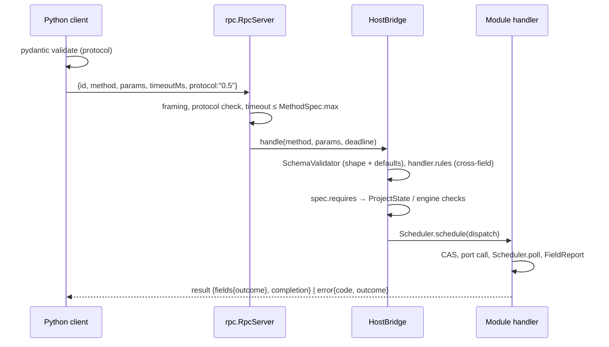
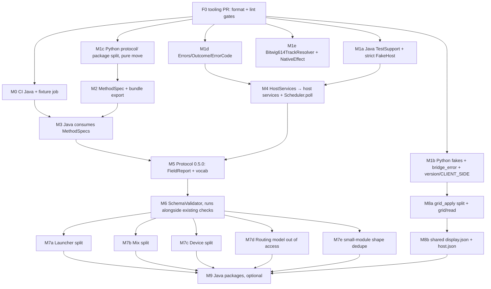

# bitwig-agent target architecture

Status: approved by the maintainer on 2026-11-26 with every recommended option in §7. Refactor PRs reference the slice IDs in §6. Based on `main` @ `059a39e`; file and line references describe that commit.

## 0. Why

The code works and the fail-closed write model is sound. The cost is in maintenance:
- Facts are written down in several places: method metadata in up to 6, unit tables in 2, ~600 lines of request-shape bounds in 2 languages, version strings in 3.
- Verification vocabulary has drifted. Java emits **~40 distinct `verification` strings**, e.g. `already_at_value`, `already_matched_readback`, `observer_after_write`, `exact_native_model_readback`, `native_job_latch_and_file_headers`. Those mix two things: *what happened* and *how we know*.
- `HostServices` is a god object, and transport/composition hold domain policy (`HostBridge.PROJECT_WRITES`, `RpcServer.maxTimeoutMs` importing `GridModule`/`ProjectModule`/`RenderModule`).
- CI never compiles Java, so the only cross-language parity check (`smoke-mcp-java.py`, `bound_parity.py`) runs only on a maintainer machine.

The target removes duplicated *facts* first and duplicated *code* second. It adds the smallest shared mechanisms that make each module single-purpose. It does not add a framework, codegen pipeline, DI container or new build system (AGENTS.md: "do not make this complex").

## 1. Target layering

### 1.1 Overall shape

```mermaid
flowchart LR
  subgraph Python["Python (wheel)"]
    P[protocol/<br/>models + MethodSpec + vocab<br/>pure, no I/O]
    D[(shared data<br/>display.json, host.json)]
    C[client.py<br/>transport + envelope checks]
    T[composed tools<br/>grid/*, audio, presets]
    A[adapters<br/>server.py MCP, cli.py]
    A --> T --> C --> P
    A --> P
    T --> P
    T --> D
  end
  subgraph Bundle["protocol bundle (generated at build)"]
    B[(protocol.json<br/>methods, schemas, vocab)]
  end
  P -- export --> B
  subgraph Java["Java (.bwextension)"]
    R[rpc<br/>RpcServer framing/admission]
    K[core<br/>MethodSpecs, SchemaValidator,<br/>Errors, FieldReport, Scheduler]
    H[host<br/>public-API state services]
    M[domain modules<br/>+ port interfaces]
    N[bitwig614<br/>native adapters]
    X[composition<br/>HostBridge]
    X --> R & M & H & N
    R --> K
    M --> K & H
    N --> K
    N -. implements ports .-> M
  end
  B --> K
  D --> K
  C <-- JSON over loopback --> R
```

### 1.2 Java layers (what each owns; dependencies point only down/inward)

| Layer | Owns | Must not |
|---|---|---|
| `rpc` (`RpcServer`, `BoundedJson`) | framing, 1 MiB bounds, envelope fields, timeout admission **from `MethodSpec`**, protocol check | import any module (fixes C1 and S2) |
| `core` | `MethodSpecs` (loaded from bundle), `SchemaValidator`, `Params` (typed reads after validation), `Errors`/`ErrorCode`/`Outcome`, `FieldReport`, `Scheduler`, `HostOperation` | touch host proxies |
| `host` | replaces `HostServices`: `HostProxies` (read-only banks), `TrackWindow` (slot lookup, `tracksObserved` accessor), `ProjectState` (readiness, modified, engine), `TransportSafety` (one `SafetyObservation` rule set, D6), `SelectionLease`, `NativeRuntime` (lazy `Bitwig614Runtime` holder), `DeviceSources` | contain domain rules or JSON envelopes |
| domain modules | request semantics, cross-field rules, CAS, dispatch, and result JSON; each module declares **port interfaces** for native work (pattern already in `MixModule.GroupAccess`, `GridAdapter`) | parse raw requests the schema already covers; reference `Bitwig614*` classes directly |
| `bitwig614` | descriptor binding, `Bitwig614TrackResolver`, invocation on the model thread; returns **plain records** (`Channel`, `Bus`, `NativeEffect(op, undo)`) | build JSON, parse requests, apply domain rules (S4: routing cycle/kind rules move to `RoutingModel`) |
| composition (`HostBridge`, `BitwigAgentExtension`) | wiring only: builds services, modules and adapters; checks handler set == host methods in the bundle | hold method lists or warning text |

**What replaces `HostServices`:** the services above are passed to each module's constructor. Each module gets only the services it uses, e.g. `SceneModule(Scheduler, TransportSafety, LauncherStructureLock)`. There is no holder object. That is what makes modules testable against small fakes instead of a whole host. The launcher/scene shared lock becomes `LauncherStructureLock` in `host` (C2). Aggregators (`DiscoveryModule`, `ContextModule`) iterate `HostModule.capabilities()` instead of naming concrete modules (C2).

**`HostModule` contract (interface, not code):**
`Map<String, MethodHandler> handlers()`. Each `MethodHandler` has `rules(JsonObject)` (cross-field/domain rules only, default none), `dispatch(HostOperation, JsonObject)`, plus `capabilities()`, `flush()` and `unresolved()`. This removes the parallel `VALIDATORS` registry and the unused `HostModule.validate` (D4, I8).

**Where native stops:** the native boundary is the port interface. Everything above it is host-free and testable offline. Everything below it is binding plus one model-thread call. `BitwigAgent614GridInsertion` stays in the default package (loader constraint), behind `GridInsertionBridge`.

**Packages:** the target is `dev.bitwigagent.{rpc,core,host,bitwig614}` plus domain packages (`grid`, `launcher`, `mix`, `device`, `project`). Java packages are the only compile-time enforcement of these boundaries. Because the code relies on package-private visibility, moving is a large mechanical PR, so it is the **last** slice (M9, optional; decision 1).

### 1.3 Python layers

| Package | Owns | Imports allowed |
|---|---|---|
| `protocol/` (replaces `schema.py` + `catalog.py`) | one module per domain mirroring Java (`tracks`, `devices`, `launcher`, `grid`, `routing`, `render`, …). Each holds that domain's pydantic models **and** its `MethodSpec`s (description, examples, flags). `protocol/base.py`: `Args` base, `MethodSpec`, `Outcome` enums, timeout classes. `protocol/__init__`: registry, `validate_call`, `export_bundle()` | stdlib, pydantic, shared data |
| `client.py` | loopback transport, envelope validation, `bridge_error(...)` (one failure helper, D7), protocol check | `protocol` |
| composed tools (`grid/`: `spec`, `plan`, `display`, `read`, `warnings`, `apply`, `export`, `render`, `probe`, `docs`; `audio*`; `presets`) | multi-call client-side methods, registered in `client_side.HANDLERS` | `client`, `protocol`, shared data |
| adapters (`server.py`, `cli.py`) | MCP/CLI surface only | everything above |

`schema` and `catalog` remain as one-line re-export modules for one release only if external code imports them. Otherwise they are deleted. A 20-line pytest checks the import rules by walking the AST (no new dependency).

## 2. Single sources of truth

| Fact | Owner (one place) | Python consumes | Java consumes | Drift detection |
|---|---|---|---|---|
| Method list, read/write, project-write, `requires` (`projectReady`, `engine`), host vs client-side | `MethodSpec` in `protocol/<domain>.py` | directly | `protocol.json` read at startup into `MethodSpecs` | composition fails to load if handler set ≠ host methods in bundle (exists today as `IllegalStateException`, now against the bundle) |
| `timeoutMs` default and ceiling | the model's `timeoutMs` field (`Args` vs `LongArgs` base; `catalog.max_timeout_ms` already derives from it) | directly | bundle (`defaultTimeoutMs`, `maxTimeoutMs`) | none needed; Java has no constant left (`RpcServer.MAX_TIMEOUT_MS`, `GridModule.MAX_TOPOLOGY_TIMEOUT_MS` deleted) |
| Request shapes, bounds, enums, defaults | pydantic models | directly | bundle JSON Schema via `SchemaValidator` (validate **and fill defaults**, so Java stops hard-coding defaults) | fixture layer: catalog examples plus generated boundary vectors (±1 on every min/max/length, unknown field, wrong type) must give the same accept/reject on both sides. Replaces `bound_parity.py` |
| Cross-field rules (54 `@model_validator/@field_validator` in `schema.py`) | Python model **and** the Java domain `rules()` where host safety depends on them | — | `MethodHandler.rules` | fixture replays the Python negative test cases against Java (only for methods whose Java `rules()` claims the rule) |
| Outcome vocabulary (field and error) | `protocol/base.py` enums | directly | bundle; Java `Outcome` enum wire names asserted equal at load | load-time check |
| Display units, seconds table, quantity grammar, tolerance, type-name rule, **test vectors** | `shared/display.json` (hand-authored, package data) | `importlib.resources` | resource in jar, Gson | both test suites run the vectors in the file |
| Bitwig host target (`6.1.4`, API 25, JAR SHA-256) | `shared/host.json` | grid schema file selection (replaces `grid_apply.BUNDLED_HOST_VERSION`) | `Bitwig614Runtime` gate | CI uses the same file to pick `extension-api` version |
| Package version | `pyproject.toml` | `importlib.metadata` (fixes `server.py:58` `"0.4.0"`) | `bitwig-agent-build.properties` (already written by `build.py`) | none needed |
| Pinned build/test jars (gson, extension-api, test runner, formatter, PMD) | one table, e.g. `extension/deps.toml` | `build.py`, `test-java.py`, CI | — | SHA check at download (existing pattern in `build.py:gson_jar`) |

**Generated vs read:** Java **reads** the bundle and data files at runtime with Gson (a ~100-line loader). There is no Java codegen. The bundle is produced by `python -m bitwig_agent.protocol export` inside `build.py` and `test-java.py`, which are already Python. Decision 7: generate only at build time (recommended, no drift possible) or also commit it for reviewable protocol diffs plus a `git diff --exit-code` CI check.

**Why Java stays an independent validator under (c):** the *rules* are shared, but the Java *validator* is separate code that runs on every TCP request. A direct TCP caller still cannot bypass validation. That preserves the defence-in-depth stance in `architecture.md`.

**`SchemaValidator` scope (evidence: keyword census over all 107 tool schemas):** `type, minimum, maximum, exclusiveMinimum, minLength, maxLength, pattern, enum, const, required, additionalProperties, items, minItems, maxItems, $ref/$defs, anyOf, oneOf, default`. That is about 250 lines on Gson. It fails closed: any keyword it does not implement makes the extension refuse to load, so a new pydantic construct cannot silently pass. Known semantic traps, each covered by vectors:
- string length: pydantic counts code points, Java `String.length()` counts UTF-16 units. Use `codePointCount`. Domain limits documented as UTF-16 (string panels, `PROTOCOL.md:482`) stay in `rules()`.
- `null` inside `anyOf` (`expectedAmount`, `expectedSource`, `slots[]`): today `Params.fields` rejects `null` everywhere.
- strict integer vs number, and Python `re` vs `java.util.regex`: patterns are restricted to the common subset, and a test compiles every pattern on both sides.

## 3. Shared mechanisms (interfaces)

**Errors** (`core.Errors`, D9). Every rejection goes through a few calls: `Errors.notApplied(ErrorCode, msg)`, `Errors.unknown(ErrorCode, msg)` and `Errors.invalid(msg)`. `ErrorCode` is a Java enum, so the 67 hand-built `new RpcException(...)` calls and the 53 static imports of `HostServices.failure` disappear. `HostOperation.fail` keeps its rule that any error after dispatch becomes `unknown`. Python gets one `bridge_error(code, msg, outcome, **details)`.

**FieldReport** (D1). One classifier that every per-field write uses:
```
FieldReport.field(key, requested, observed, dispatched, observedAfterWrite, matches, targetCurrent)
  -> outcome: !dispatched&&matches → already_matched; !dispatched → not_applied;
              !targetCurrent → unknown(target_changed); !observedAfterWrite → unknown(not_observed);
              matches → applied; else unknown(readback_mismatch)
FieldReport.toJson()  -> {fields:{k:{requested, observed, outcome, reason?}}, completion}
```
`completion` is `observed` only if every field is `applied` or `already_matched`. It is `unknown` if any field is `unknown` or `not_applied` after another field was dispatched (today's fail-closed rule in `MixModule.finish`/`TransportModule.finish`). It is `not_observed` only for methods whose spec says `verify: dispatch_only` (`tracks.select`, `actions.invoke`, queued launches).

**Scheduler** (D2). `schedule(op, task, delay)`, `check(op)` and `poll(op, untilNanos, Guard guard, BooleanSupplier done, Runnable onDone, Runnable onTimeout)`. The period (`20` ms, repeated 37 times) and the deadline margin live in one place. Recursive `awaitX` loops and the 35 `System.nanoTime() >= until` checks go away. The clock is injected, so timing tests need no sleep.

**Native track resolution** (D3). `Bitwig614TrackResolver.bind(access)` binds `getDeepestTarget`, `RYd.kFU`, `iKU.kFU` and `AVL.IwV` once. It offers `model(trackProxy, trackId)`, which returns the model or throws `stale_context`, and `same(proxy, model)`. Seven access classes stop re-binding obfuscated descriptors, so a host-version port touches one file. Provenance becomes data: access methods return `NativeEffect(op, undo)`, and the domain envelope adds `nativeOperation/nativeUndo/nativeVersion/nativeJarSha256` in one helper.

**Request lifecycle after the change**



The `transport.set` inactive-engine warning moves into `TransportModule` (it depends on params), so `HostOperation.decorate`, a mutable hook (C3), is deleted.

## 4. Protocol 0.5.0

**Changes (only this slice is not behaviour-preserving):**
1. Per-field results become `{requested, observed, outcome, reason?}`.
   - `outcome` ∈ `applied | already_matched | not_applied | unknown`.
   - `reason` (only for `not_applied`/`unknown`) ∈ a small closed set: `target_changed | not_observed | readback_mismatch | deadline | not_dispatched_after_failure`.
   - `verification` and per-field `matchesRequested` are removed.
2. **How** a method verifies (observer, native readback, job latch plus file headers, count delta, document event) becomes static metadata in `MethodSpec.verifiedBy`, shown by `describe`/MCP description. It is no longer a per-response string. This replaces most of the ~40 strings. Decision 2: alternatively keep a coarse per-response `evidence` enum.
3. Top level: keep `completion` (`observed | not_observed | unknown`; `NativeOutcomeGuard` keys on it). Remove `status` and top-level `matchesRequested` because both restate `completion`. Grid entry `status:applied/already_matched` (`grid_apply.CLEAN`) becomes `outcome`. Decision 3.
4. `error.outcome` stays `not_dispatched | not_applied | unknown`. `not_dispatched` is client-only and means nothing reached the host. Decision 4: keep it, or fold it into `not_applied`.
5. Protocol check, fail-closed: the client sends `protocol:"<major.minor>"`, derived from the package version (no new version string).
   - The extension rejects a missing or different value with `protocol_mismatch` / `not_applied`.
   - An old 0.4 extension already rejects the unknown envelope field (`RpcServer` allowlist at `:22`), so mixed versions fail closed in both directions.
   - This replaces relying on the status-only `extensionMismatch` warning (`client.py:25`). Decision 5.

**Migration for agent users:** this is a lockstep release. `bitwig-agent-install` already fetches the matching extension. No dual-vocabulary period. The same PR updates:
- `PROTOCOL.md` (outcome table replaces per-method verification strings)
- `skills/bitwig-agent/references/targeting-and-evidence.md` and `troubleshooting.md`
- `scripts/smoke-native.py` (`NativeOutcomeGuard`: per-field `outcome == "unknown"` in addition to `completion`)
- `grid_apply` report counters
- a "0.4 → 0.5" table in the release notes mapping every old `verification` string to `outcome` + `reason`

Agents on 0.4 that upgrade only one side get `protocol_mismatch` instead of misreading results.

## 5. Test architecture

| Layer | What | Fakes | CI |
|---|---|---|---|
| Python unit | protocol models, planners, display/name vectors, import rules | `tests/fakes.py` (one `FakeGrid`, `FakeClient`); no cross-test imports (D8) | yes |
| Java unit | `core` (validator, `FieldReport`, `Scheduler` with fake clock), domain modules against fake **services and ports**, `RoutingModel` etc. moved out of access classes (I5), direct `Params`/`EnumOptions` tests | `FakeHost`: one strict dynamic proxy; unexpected API calls throw; lenient only by explicit opt-in (fixes the `HostBridgeTest` silent-default fake) | **new** |
| Contract/parity | bundle loads in Java; handler set == host specs; outcome enum names; display vectors on both sides | — | **new** |
| Fixture | Python client ↔ real Java `RpcServer`/`HostBridge` on `FakeHost` (`smoke-mcp-java.py`): every catalog example, generated boundary vectors, replayed negative cases | `FakeHost` | **new** |
| Package | wheel/sdist consumers; bundle and `shared/*.json` present in wheel and in a CI-built jar | — | yes (exists) |
| Native E2E | disposable project, `NativeOutcomeGuard`, single writer (AGENTS.md) | none | manual only; required for slices that touch `bitwig614` |

**Java in CI:**
- `com.bitwig:extension-api:25` **is published** on `maven.bitwig.com` (metadata lists version `25`). The POM declares no licence; CI downloads it at build time pinned by SHA and never redistributes it (decision 9).
- Compile `extension/src/main/java/dev/**` plus tests against it plus gson, with `-Xlint:all -Werror`. Exclude only the default-package `BitwigAgent614GridInsertion.java`. It is loaded by name from `Bitwig614GridInsertionAccess`, so nothing else breaks. Hand-written signature stubs are rejected because they would only prove our own guesses.
- The release `.bwextension` build stays local against the real `bitwig.jar`.
- Test runner: decision 8. Recommended: JUnit 5 via the single `junit-platform-console-standalone` jar. It runs in one JVM, gives named results and needs no Maven/Gradle; the existing `main` tests migrate file by file. The alternative is to keep the mains plus a shared `TestSupport`.

## 6. Migration plan (PR slices)

Rules:
- Every slice is behaviour-preserving except **M5**. A slice that removes a constant first asserts that the derived value equals it, in a test that lives in that PR.
- Slices that touch `.py`/`.java` branch after the tooling PR's formatting commit (F0) and its ruff/mypy strict gates.
- Each module split carries its own comment sweep and banner removal.



| Slice | Files (main) | Verify | Parallel with |
|---|---|---|---|
| **M0** CI Java/fixture job: `deps.toml`, fetch `extension-api-25` + gson, compile excluding insertion class, run existing 32 mains, `smoke-mcp-java.py`, `bound_parity.py` | `.github/workflows/ci.yml`, `scripts/test-java.py`, `scripts/build.py` (deps table) | deliberately broken validator fails CI | after the tooling PR (both edit `ci.yml`); else alone |
| **M1a** `TestSupport`, strict `FakeHost`; migrate 6 local fakes and ~30 `check/expect` copies | `extension/src/test/**` only | same or higher assertion count | M1b–M1e |
| **M1b** `tests/fakes.py`; `bridge_error`; `server.py` version from metadata; `CLIENT_SIDE = frozenset(HANDLERS)` | `tests/**`, `client.py`, `server.py`, `catalog.py` (1 line), `grid_export/render/probe.py` (`_fail` only) | pytest count unchanged | M1a, M1d, M1e. Conflicts with M1c on `catalog.py` (1 line): land first |
| **M1c** `protocol/` package: models + specs per domain, descriptions as constants, re-exports | `schema.py`, `catalog.py`, new `protocol/*` | `model_json_schema()` for all 107 tools byte-identical before/after | M1a, M1d, M1e |
| **M1d** `core.Errors`, `ErrorCode`, `Outcome`; `HostServices.failure` delegates | new files + `HostServices.java` (one method) | `test-java.py` | M1a–M1c, M1e |
| **M1e** `Bitwig614TrackResolver`, `NativeEffect`; 7 access classes | 7 `Bitwig614*Access` + new files | `Bitwig614RuntimeTest`, **native E2E** (routing, arranger, automation, render, group) | all of M1 |
| **M2** `MethodSpec` fields (`write`, `projectWrite`, `requires`, `verifiedBy`, `host`), `export_bundle()`, bundle into jar/test classpath | `protocol/*`, `build.py`, `test-java.py` | Python test: spec-derived sets == `HostBridge.PROJECT_WRITES`, engine set, long-timeout set (parsed from Java source once, deleted in M3) | M4 |
| **M3** `HostModule.handlers()`; `HostBridge`, `RpcServer`, `DiscoveryModule` derive from `MethodSpecs`; delete `PROJECT_WRITES`, `LONG*`, `SAVE_AS`, `VALIDATORS`, instance `validate`; `grid_apply.TOPOLOGY_WRITES` → spec | `HostModule`, `HostBridge`, `RpcServer`, `DiscoveryModule`, one declaration per module, `grid_apply.py` (1 constant) | `HostBridgeTest`/`RpcServerTest`; fixture registry | M4 (only `HostBridge` overlap: M4 does not edit it) |
| **M4** `host.*` services, `TransportSafety` dedupe (D6), `Scheduler.poll`; migrate Scene/Marker/Transport loops; encapsulate `tracksObserved`, `devices[]`, `selectionOwner` (C3) | `HostServices.java` → new files, `DeviceSources`, `SceneModule`, `MarkerModule`, `TransportModule`, `DiscoveryModule` (field reads) | `test-java.py`; fake-clock poll test | M3 (serialize the `DiscoveryModule` hunk) |
| **M5** **Protocol 0.5.0**: `FieldReport`; migrate all ~28 files emitting `verification`; protocol check; docs/skills/guard | modules emitting results, `RpcServer`, `client.py`, `grid_apply.py`, `smoke-native.py`, `PROTOCOL.md`, `skills/**`, version bump | every Java/Python result assertion updated by the old→new mapping table; native E2E smoke | **nothing else touching modules** |
| **M6** `SchemaValidator` + defaults; runs *in addition to* existing Java checks | `core/*`, `HostBridge` (1 call) | boundary vectors in fixture; any new rejection is a found divergence, fixed in Python or noted | M8a |
| **M7a–d** module splits (audit S3/S4), each migrating its loops to `Scheduler.poll` and deleting shape checks now covered by M6 | disjoint `Launcher*`/`Mix*`/`Device*`/`Routing*` sets; one registration line each in `HostBridge` | split tests; native E2E for the touched domain | each other, M7e, M8b |
| **M7e** shape dedupe in unsplit modules (Arranger, Automation, Render, Project, Marker, Scene, Grid validators) | those modules | fixture vectors | M7a–d |
| **M8a** `grid/` package split of `grid_apply` (S5) + one `read_graph` (D7) | `grid_apply.py`, `grid_export.py`, `grid_render.py`, `grid_probe.py` | no diff on `tests/grid-cases.json` | M2–M7 |
| **M8b** `shared/display.json` + `host.json`; `GridDisplayUnits`, `GridNames`, `grid/display.py`, `grid_docs` read them; one type-name rule | those files, `Bitwig614Runtime` (gate constants) | vectors on both sides; name-rule change listed in release notes | M7a–e |
| **M9** (optional) Java subpackages | all Java | compile + full tests; no logic diff | alone, last |

Rough critical path: F0 → M1c → M2 → M3 → M5 → M6 → M7*. M1a/b/d/e, M4 and M8a fill the parallel lanes.

## 7. Risks, rejected alternatives, decisions

**Risks**
- *Schema-driven Java validation drops a rule.* Mitigation: M6 runs alongside the old checks first. Shape code is deleted only per module (M7) once vectors pass. Cross-field rules stay explicit in `rules()`.
- *Bundle is missing or stale in an installed jar.* The extension refuses to load (fail closed) and `status` reports it. `build.py` generates the bundle in the same step.
- *Native regressions from M1e/M7d only show on a live host.* Those slices require native E2E on a disposable project (AGENTS.md).
- *M5 is wide (~28 Java files).* One owner, mechanical mapping table, nothing else in flight on modules.
- *The display data file removes table duplication, not parser duplication.* About 15 lines of parse/near logic stay on each side. Formulas are named (`midi_note_hz`, `scale`, `identity`, `cbrt`, `log10`) and implemented on both sides, held in line by the vectors in the same file. This is a refinement of direction (a): data files cannot carry formulas.
- *Message-text changes visible to direct TCP callers*, e.g. the `invalid_params` wording from `SchemaValidator`, or a missing `timeoutMs` on `project.saveAs` now defaulting to the spec's 30000 instead of 5000. Codes and outcomes stay the same.

**Rejected (briefly)**
- Java codegen from the schema (records/validators): adds a build step and generated-code review, with no Maven/Gradle to host it.
- A JSON Schema library (networknt/everit): pulls in Jackson/org.json and grows the extension, for a schema that uses 18 keywords.
- Java or a hand-authored IDL (OpenAPI/protobuf) as the source: a third language; Python already owns descriptions and MCP schemas.
- Python delegating display conversion to the host (audit D5 option b): `grid.apply` must reject unsupported display writes *before* the first write to avoid partial applies.
- Gradle/Maven migration: the scripted `javac` build is small; pinned jars plus `deps.toml` are enough.
- A DI framework or a service locator replacing `HostServices`: constructor wiring in `HostBridge` is about 40 lines.
- A dual-vocabulary transition or capability negotiation: lockstep releases make a fail-closed check simpler.

**Decisions** (all resolved with the recommended option)
1. Approve the layering in §1. Do the Java package move (M9) at the end, or stay in one package?
2. 0.5.0 field shape: drop per-response `verification` and move "how verified" to `MethodSpec.verifiedBy` (recommended), or keep a coarse per-response `evidence` enum?
3. Top level: keep `completion`, remove `status` and `matchesRequested` (recommended), or introduce a top-level `outcome`?
4. Keep `not_dispatched` as a distinct client-only error outcome (recommended), or fold it into `not_applied`?
5. Add the fail-closed `protocol` envelope check (recommended), or keep only the existing `extensionMismatch` warning?
6. Type-name matching: adopt Java `GridNames.resolve` (exact → case-insensitive → normalized; symbol-only names exact only) for all three call sites, keeping `grid_docs`'s typeId-first lookup as a separate ID step (recommended)? This changes matches for some inputs.
7. Protocol bundle: build-time only (recommended), or also committed with a CI drift check?
8. Java test runner: JUnit 5 console-standalone (recommended), or home-grown mains plus `TestSupport`? Coordinate with the tooling PR.
9. CI downloads `com.bitwig:extension-api:25` from maven.bitwig.com (no licence in POM, not redistributed) and excludes the default-package insertion class from CI compilation. OK?
10. Accept the direct-TCP-visible changes in §7 risks (validator message text, spec-derived default timeouts)?
11. Host target (`6.1.4`/API 25/SHA): shared `host.json` (recommended), or keep the Java constant as owner and have Python read it from `capabilities`?
